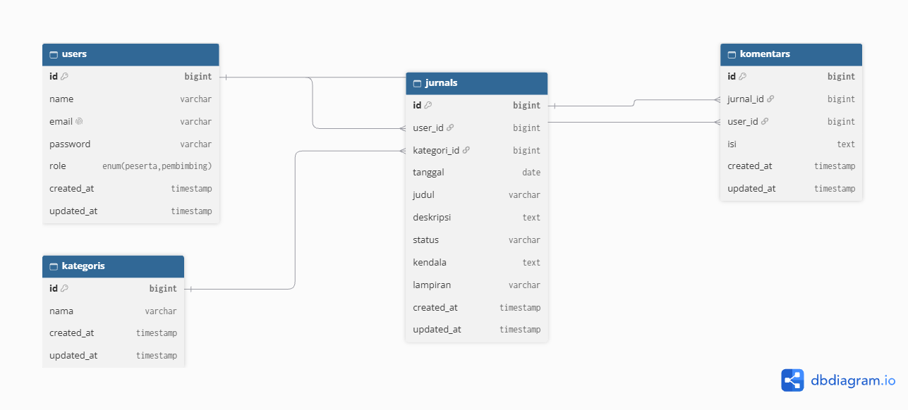

# Aplikasi Jurnal Harian PKL — PT Metanouva Informatika

Aplikasi web dan REST API berbasis Laravel untuk pencatatan, pemantauan, evaluasi, dan pelaporan kegiatan harian peserta Praktik Kerja Lapangan (PKL).

## Fitur Utama

- **Autentikasi & Manajemen Role:** Pembagian hak akses antara **Peserta PKL** dan **Pembimbing PKL** (web session dan Laravel Sanctum token).
- **Manajemen Jurnal Harian:** Peserta dapat membuat, melihat, memperbarui, mencari/memfilter, dan menghapus catatan kegiatan harian berdasarkan kategori.
- **Evaluasi & Komentar Pembimbing:** Pembimbing dapat meninjau seluruh jurnal peserta, memberikan status evaluasi, serta menambahkan catatan/komentar.
- **Dashboard Statistik:** Ringkasan jumlah jurnal dan aktivitas sesuai masing-masing role.
- **Export Laporan:** Fitur unduh rekap laporan jurnal dalam format PDF untuk keperluan dokumentasi PKL.
- **REST API & Kontainerisasi Docker:** Endpoint API terproteksi Sanctum lengkap dengan koleksi Postman dan konfigurasi Docker Compose.

## Kebutuhan Sistem

- **Opsi Docker:** Docker Desktop (Docker Engine & Docker Compose)
- **Opsi Manual:** PHP >= 8.2, Composer, MySQL 8.0 / MariaDB, Node.js & NPM

---

## Cara Menjalankan Proyek

### 1. Menggunakan Docker (Direkomendasikan)

1. Pastikan **Docker Desktop** sudah berjalan dan layanan MySQL/Apache lokal (XAMPP) dalam keadaan nonaktif.
2. Salin konfigurasi environment:
   `cp .env.example .env`
3. Jalankan container aplikasi, web server Nginx, dan database MySQL:
   `docker compose up -d --build`
4. Jalankan migrasi dan seeder database:
   `docker compose exec app php artisan migrate --seed`
5. Buka aplikasi melalui browser di **`http://localhost:8000`**.

### 2. Menggunakan Server Lokal (Manual / XAMPP)

1. Jalankan modul **MySQL** di XAMPP dan buat database baru (`db_jurnal`).
2. Salin `.env.example` menjadi `.env`, lalu sesuaikan `DB_HOST=127.0.0.1`, `DB_DATABASE=db_jurnal`, `DB_USERNAME=root`, dan `DB_PASSWORD=`.
3. Instal dependensi dan jalankan migrasi secara berurutan:
   `composer install` → `php artisan key:generate` → `php artisan migrate --seed` → `php artisan serve`
4. Buka aplikasi melalui browser di **`http://127.0.0.1:8000`**.

---

## Akun Uji Default (Hasil Seeder)

| Role | Email | Password |
| :--- | :--- | :--- |
| **Peserta PKL** | `peserta@metanouva.co.id` | `password` |
| **Pembimbing PKL** | `pembimbing@metanouva.co.id` | `password` |

---

## Desain Database (ERD)

Struktur relasi antar tabel utama (`users`, `kategoris`, `jurnals`, dan `komentars`):

---

## Dokumentasi REST API

Koleksi lengkap endpoint API siap impor tersedia di dalam repositori pada file:
`postman/Jurnal_PKL_API.postman_collection.json`

| Metode | Endpoint | Keterangan | Akses |
| :--- | :--- | :--- | :--- |
| `POST` | `/api/login` | Autentikasi pengguna dan mendapatkan Bearer Token | Publik |
| `POST` | `/api/logout` | Menghapus token aktif pengguna | Bearer Token |
| `GET` | `/api/jurnals` | Menampilkan daftar jurnal (mendukung filter) | Bearer Token |
| `POST` | `/api/jurnals` | Menambahkan entri jurnal baru | Bearer Token (Peserta) |
| `GET` | `/api/jurnals/{id}` | Melihat detail jurnal beserta komentar | Bearer Token |
| `PUT` | `/api/jurnals/{id}` | Memperbarui data jurnal | Bearer Token (Pemilik) |
| `DELETE` | `/api/jurnals/{id}` | Menghapus data jurnal | Bearer Token (Pemilik) |

---

## Pengujian Otomatis (Automated Testing)

Jalankan seluruh rangkaian *Feature Test* menggunakan perintah:

`docker compose exec app php artisan test`

---

## Skenario Demo Aplikasi

1. **Alur Peserta:** Login sebagai `peserta@metanouva.co.id` → cek ringkasan Dashboard → buat jurnal kegiatan baru → uji filter/pencarian jurnal → cek halaman error kustom (`403`/`404`) → logout.
2. **Alur Pembimbing:** Login sebagai `pembimbing@metanouva.co.id` → pantau daftar jurnal peserta di Dashboard → buka detail jurnal dan kirim komentar evaluasi → jalankan fitur Export PDF.
3. **Alur REST API & Testing:** Uji endpoint `POST /api/login` dan `GET/POST /api/jurnals` melalui Postman menggunakan Bearer Token, lalu jalankan `php artisan test` untuk memverifikasi kelulusan 37 skenario pengujian.